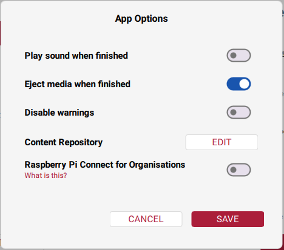
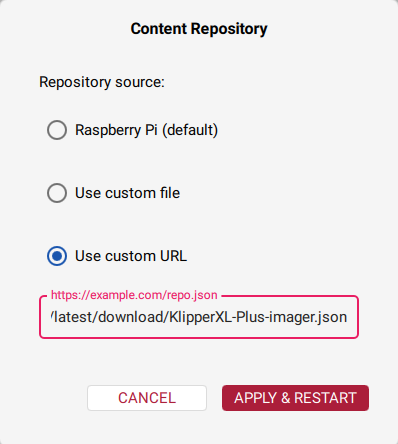
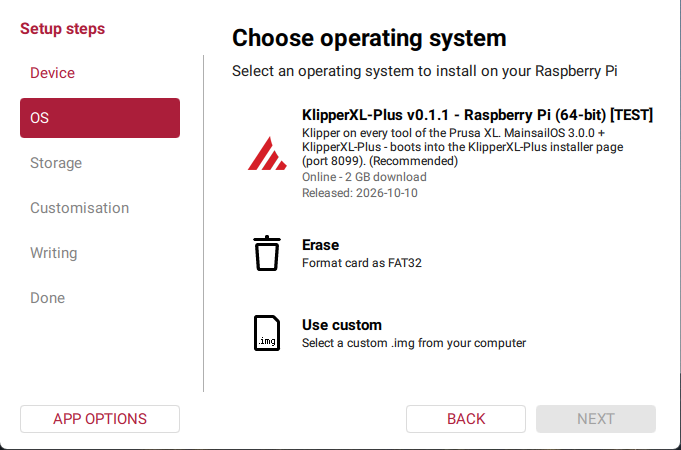
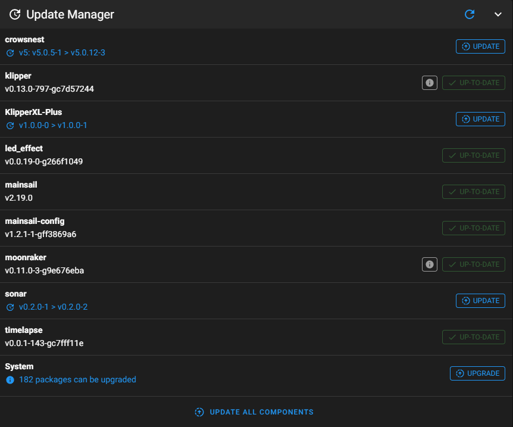

# KlipperXL-Plus Installation Guide

Klipper on a Prusa XL: the XLBuddy runs Klipper as the bridge to the tools,
**all tools (1-5) run Klipper**, and the bed keeps its stock Prusa firmware.
The install is automatic and runs from a **web page on the Pi**: flash the
KlipperXL-Plus SD card image with Raspberry Pi Imager, boot the Pi, open the
page, and follow it - no command line.

> ⚠️ **Read this before you start - the appendix.** The Prusa bootloader
> verifies firmware signatures and will reject unsigned Klipper firmware
> unless the **appendix** (safety seal) on the XLBuddy is broken. Breaking it
> is a **physical, irreversible modification to your mainboard** - it cannot
> be undone, and it is the same requirement as for any custom firmware on the
> XL. Everything else here is reversible: you can flash stock Prusa firmware
> back at any time and the printer returns to normal. The appendix is the one
> step that does not come back. Decide about it before you begin, not halfway
> through.
>
> **With the appendix intact, none of this works** - the bootloader refuses
> the KlipperXL-Plus firmware. The installer page asks you to confirm it before
> it does anything.

---

## Contents

1. [What you need](#1-what-you-need)
2. [Flash the KlipperXL-Plus SD card](#2-flash-the-klipperxl-plus-sd-card)
3. [Already have a MainsailOS card? (instead of 2)](#3-already-have-a-mainsailos-card-instead-of-2)
4. [The installer page](#4-the-installer-page)
5. [Calibrate](#5-calibrate)
6. [Slicer](#6-slicer)
7. [Updating](#7-updating)
8. [Going back to stock Prusa firmware](#8-going-back-to-stock-prusa-firmware)
9. [Troubleshooting](#9-troubleshooting)

---

## 1. What you need

- Prusa XL with the XLBuddy mainboard, 1 to 5 tools
- **The appendix on the XLBuddy broken** (see the warning above)
- Raspberry Pi 4 or 5 (64-bit) - tested on a Raspberry Pi 4
- MicroSD card, 16 GB or more
- USB cable from the Pi to the XLBuddy (USB-A to USB-C)
- A **FAT32 USB stick** - the XLBuddy firmware goes onto the printer from it
- A network connection for the Pi (Ethernet or Wi-Fi)
- A computer with a web browser on the same network

Everything is built on the Pi itself - no separate build computer.

## 2. Flash the KlipperXL-Plus SD card

The KlipperXL-Plus image is MainsailOS (Raspberry Pi OS with Klipper,
Moonraker and Mainsail) with KlipperXL-Plus and its installer page on it.

1. Open **Raspberry Pi Imager** (version 2.0 or newer).
2. Add the KlipperXL-Plus list to Imager:
   - click **APP OPTIONS** (bottom left)
   - next to **Content Repository**, click **EDIT**

     

   - choose **Use custom URL** and paste:

     ```
     https://github.com/racoutlaw/KlipperXL-Plus/releases/latest/download/KlipperXL-Plus-imager.json
     ```

     

   - click **Apply & Restart**. Imager's title bar now says *"Using data
     from ..."* - the KlipperXL-Plus list is loaded.

     Imager does not remember this setting. If you close Imager and open
     it again later, do this step again.
3. Device: your Raspberry Pi (4 or 5). Operating system: **KlipperXL-Plus**
   (not *Use custom* - with *Use custom* Imager cannot set your Wi-Fi and
   user). Storage: the SD card.

   
4. In Imager's customisation settings, set:
   - a hostname (e.g. `KlipperXL-Plus`)
   - your **username and password** (you need the password again on the
     installer page)
   - your **Wi-Fi** (skip if the Pi is on Ethernet)
   - **SSH enabled**
5. Write the card, put it in the Pi, connect the Pi to the XLBuddy with the
   USB cable, and power everything on. **The first boot takes a few minutes
   and the Pi restarts once by itself.**
6. Open **`http://<your Pi>:8099`** in a browser (the Pi's address from your
   router, or `http://<hostname>.local:8099`). The installer page is there -
   carry on with [section 4](#4-the-installer-page).

   **Give it time:** the page only starts after the Pi's restart, about
   1-2 minutes after the Pi is back up - all in all **5 minutes or so** from
   power on. If the browser says it cannot connect, wait a minute and reload.

(Mainsail is at `http://<your Pi>` - Klipper shows an error about
`printer.cfg` there until the install is done; that is expected.)

## 3. Already have a MainsailOS card? (instead of 2)

On a card flashed with **MainsailOS** (Raspberry Pi Imager: Other
specific-purpose OS → 3D printing → Mainsail OS → 64-bit), the installer page
is put on the Pi with one line typed into a **terminal** connected to the Pi
(that is "SSH"). After that, everything happens in your browser.

### 3.1 Never used a terminal? Start here

1. **Open a terminal on your computer.**
   - Windows: press **Start**, type **Terminal** (Windows 11) or
     **PowerShell** (Windows 10), press Enter.
   - Mac: **Launchpad → Terminal**. Linux: your Terminal app.
2. **Connect to the Pi.** Type this, with the username you set in Imager and
   the Pi's address (from your router, or the hostname you set), then Enter:

   ```bash
   ssh yourname@192.168.1.50
   ```

3. The **first time** it asks *"Are you sure you want to continue connecting
   (yes/no)?"* - type `yes` and press Enter.
4. Type your **password** and press Enter. **Nothing appears on the screen
   while you type it - no dots, no stars. That is normal.**
5. You are connected when the last line ends in `$`, like
   `yourname@hostname:~ $`.

**To paste the line below:** copy it here, click in the terminal, paste
(**Ctrl+V** or **right-click** on Windows, **Cmd+V** on a Mac,
**Ctrl+Shift+V** on Linux), and press **Enter**.

*Flashed the SD card again and `ssh` now refuses with "REMOTE HOST
IDENTIFICATION HAS CHANGED"? The fresh card has a new identity - run
`ssh-keygen -R 192.168.1.50` (your Pi's address) on your computer and connect
again.*

### 3.2 The one line

```bash
git clone https://github.com/racoutlaw/KlipperXL-Plus.git ~/KlipperXL-Plus && bash ~/KlipperXL-Plus/scripts/bootstrap_kxlplus.sh
```

It checks the Pi and prints the installer page's address:

```
  The KlipperXL-Plus installer is running. Open this page in a browser on
  any computer on your network:

      http://192.168.1.50:8099
```

Open that address in your browser. **You can close the terminal now** - the
install carries on in the page.

## 4. The installer page

### 4.1 Before you press Start

The page starts with the appendix warning. Then:

- **tick the box** - the appendix on your XLBuddy is broken and you accept
  the warning
- **turn the printer on** and leave it connected to the Pi by USB
- **Is a touchscreen connected to the Pi?** - *Yes* installs KlipperScreen
- **your Pi password** (the one from Raspberry Pi Imager) - the installer
  needs it to install packages; it is used once and not saved

Press **Start**. Keep the page open - you can watch everything it does under
*Show everything the installer is doing*.

### 4.2 Run first: preparing (10-20 minutes)

The page installs the firmware build tools, updates Klipper (the firmware
for the boards is built from it, so the Pi and the boards end up on the same
Klipper), installs KlipperScreen if you chose it, copies the KlipperXL-Plus
modules into Klipper (Klipper's own files stay untouched, so Mainsail's
updates keep working), sets up the pressure advance analyser and builds the
XLBuddy and tool firmware. Nothing is written to the printer yet.

### 4.3 The XLBuddy firmware

The page asks you to **plug a FAT32 USB stick into the Pi**, shows the stick
it found and asks before writing:

- only a removable FAT32 USB stick is offered - never the Pi's own SD card
- nothing on the stick is deleted or formatted: an older `.bbf` is renamed
  `<name>.<date-time>.old`, so the printer sees only `klipper.bbf`
- the copy is read back and checked, then the stick is unmounted

Then the page shows the printer steps:

1. Plug the stick into the **printer's front USB port** and **power-cycle** the
   printer.
2. When the **Prusa logo** appears, press the **knob 2-3 times** - this opens
   the bootloader's firmware update menu. Confirm `klipper.bbf`.
3. If it asks about the signature, press **Ignore** (this is where the broken
   appendix is needed).
4. The progress bar **stops at about 50 %** - **this is normal**: Klipper has
   taken over and does not drive the printer's screen.
5. Power the printer **off**, pull the stick out, power it **on**.

Press **The XLBuddy is flashed and the printer is on - continue**.

The Prusa bootloader is never overwritten - KlipperXL-Plus is installed after it
(at 0x08020200), which is why stock firmware can always go back on.

### 4.4 Run second: the tools

1. The page lists the tools it found and asks *"Is that every tool on this
   printer?"* - *Yes* if all of yours are there.
2. It flashes each tool, one after the other, with its progress - each tool's
   current firmware is backed up first and every flash is read back and
   verified.
3. It writes the configs for exactly those tools, and a `printer.cfg` if you
   have none (an existing `printer.cfg` is never overwritten).
4. It starts Klipper and checks every board.

### 4.5 Done

The page shows **KlipperXL-Plus is installed**, with Klipper *ready* and *every
board runs this KlipperXL-Plus firmware*, and a link to Mainsail. The password
permission is removed again, and the installer page stops by itself 15
minutes later.

Your calibrations live in **your** `printer.cfg` (saved with SAVE_CONFIG).
The files under `kxlplus/` belong to the installer and are replaced each time
it runs.

The installer also adds a **"Modular Bed" camera** to Mainsail: the bed's 16
zones with their temperatures, live (Mainsail: the webcam panel; Fluidd:
Cameras). It is yours to rename, move or delete.

## 5. Calibrate

In Mainsail (or KlipperScreen): **Macros → CALIBRATION_WIZARDS**. Each wizard
is a guided dialog and saves into your `printer.cfg`. Run them in this order:

> ⚠ **Pick or park problems? Run 5. Dock positions first** - every other
> wizard picks and parks tools.

1. **Loadcell reference** - every tool (Z homing needs it)
2. **Heater PID** - every tool, each starting cold (optional: Prusa defaults
   are seeded)
3. **Filament sensors** - every tool: side sensor + tool sensor
4. **Z alignment** - levels the two Z motors against the top frame
5. **Dock positions** - measures where each dock really is (one dock or all);
   needs the dock pins out and the pillar screws loosened, the wizard says
   when. Optional on a printer whose docks pick and park cleanly; run it for
   a dock that was knocked or rebuilt
6. **Tool offsets** - calibration pin, all tools against T0 (multi-tool)
7. **Input shaper** - T0's accelerometer, X then Y
8. **Pressure advance** - every tool, filament loaded (about 6 minutes each)

Then the first layer per tool: babystep while printing, then Save in
Mainsail.

## 6. Slicer

See [SLICER_SETUP.md](SLICER_SETUP.md).

## 7. Updating

**KlipperXL-Plus is in Mainsail's update list**, next to Klipper and Mainsail
(Machine → Update Manager). When a new KlipperXL-Plus version is out it shows
**Update** there - press it: Mainsail pulls the new version and restarts
Klipper. Most updates are done at that point.



An update that also changes configs or board firmware has to be finished by
the installer page - Mainsail then shows a warning that says so. **Start the
installer page from Mainsail:** the power menu (top right) → **Service
Control** → **KlipperXL-Plus-installer** → start, then open
`http://<your Pi>:8099` and press Start. It rebuilds only firmware that
changed and flashes only the boards that need it. It never overwrites your
`printer.cfg` or your calibrations.

(The page can also be started with the one line from section 3:
`bash ~/KlipperXL-Plus/scripts/bootstrap_kxlplus.sh`.)

**The firmware check.** Every KlipperXL-Plus firmware carries an ID, and at
every start Klipper checks that each board runs the firmware this
KlipperXL-Plus built. When an update needs new firmware on a board, Mainsail
shows a warning like:

> KlipperXL-Plus: the firmware on XLBuddy, T2 is not the one this KlipperXL-Plus
> needs. To finish, start the KlipperXL-Plus installer: in Mainsail's power menu
> (top right) -> Service Control -> KlipperXL-Plus-installer -> start, then open
> http://192.168.1.50:8099

Start the installer page as above. If the XLBuddy needs new firmware, the page
takes you through the USB stick again (the printer keeps working on its old
firmware until you flash it), then the tools. A Klipper update on its own
does not trigger the warning - only a KlipperXL-Plus firmware change does.

**Klipper updates from Mainsail** work as normal: the boards keep the
firmware they were flashed with and keep working. If a Klipper update ever
needs new board firmware, Klipper itself stops with a "Protocol error" - run
the installer page again; if the error still names the XLBuddy (`mcu`),
flash `~/kxlplus-build/xlbuddy/klipper.bbf` from a USB stick as in 4.3.

## 8. Going back to stock Prusa firmware

Download the current firmware for the XL from Prusa -
[help.prusa3d.com/downloads/xl](https://help.prusa3d.com/downloads/xl) - put
its `.bbf` on the USB stick and flash it exactly as in 4.3. Prusa's factory
bootloaders were never touched (the XLBuddy's, and each tool's - the tools are
flashed through them). At boot the stock firmware checks the tools
("Verifying dwarf") and re-flashes them with Prusa's own firmware ("Flashing
dwarf"). The printer is back to normal - only the appendix stays broken.

## 9. Troubleshooting

**The installer page does not open.** Right after a fresh card, wait: the
first boot restarts the Pi once, and the page comes up 1-2 minutes after
that - about 5 minutes from power on (see 2, step 6). Use the address with
`:8099` at the end. The page stops by itself 15 minutes after an install, or 4 hours after
it was started without being used - start it again from Mainsail (power menu
→ Service Control → KlipperXL-Plus-installer), or with the one line from section 3.

**"sudo did not accept that password".** It is the password you set for
your user in Raspberry Pi Imager.

**The bootloader does not see the firmware on the stick.** Press the printer's
**reset button**, then press the knob 2-3 times right after - same as the
power-cycle method. Credit: @Ro3Deee
([KlipperXL #13](https://github.com/racoutlaw/KlipperXL/issues/13)). Also check
that `klipper.bbf` is in the **root** of a **FAT32** stick and is the only
`.bbf` there.

**The bootloader rejects the firmware / signature error with no Ignore.** The
appendix is intact. See the warning at the top.

**The progress bar stays at about 50 %.** Normal - see 4.3, step 4.

**A tool is missing from the list.** Answer *No*, check that tool's cable,
then press Start again on the page.

**The page says "The install stopped".** The last lines under *Show
everything the installer is doing* say why. Fix that and press Start again -
it skips what is already done. A tool whose flash failed stays in its Prusa
bootloader (never touched) and is flashed again.

**"... does not apply to this Klipper version".** Klipper has changed in a way
the KlipperXL-Plus firmware patches do not match yet - KlipperXL-Plus needs an
update for that Klipper version. Nothing on the printer was changed.

**Mainsail warns "the firmware on ... is not the one this KlipperXL-Plus
needs".** A board runs older KlipperXL-Plus firmware (or firmware from before
the check existed). Run the installer - see section 7.

**After a Mainsail update a page is blank or half drawn** (for example the
config editor shows only the file outline, no text). The browser still has
the old Mainsail cached: press **Ctrl+Shift+R** (Mac: **Cmd+Shift+R**) on the
Mainsail tab. Do not press *Save & Restart* in an editor that shows no text.

**Power cuts.** KlipperXL-Plus cannot resume a print after a power loss. Put the
printer and the Pi on a UPS.
